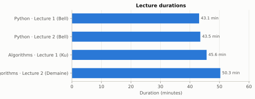
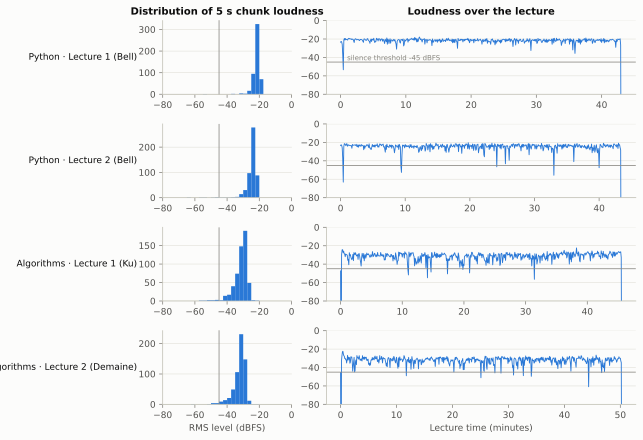
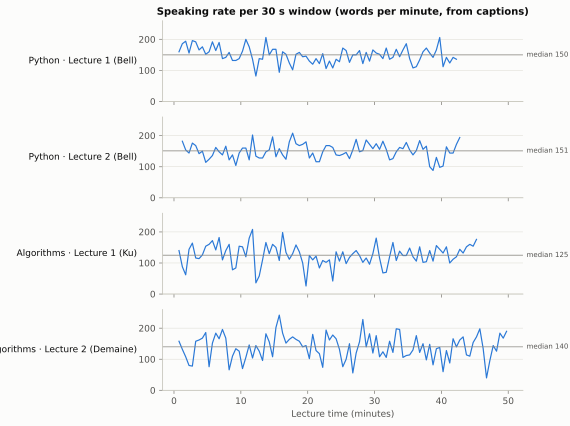
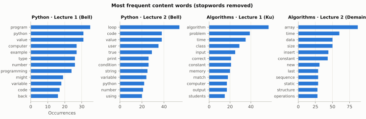
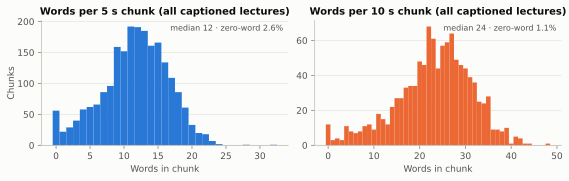
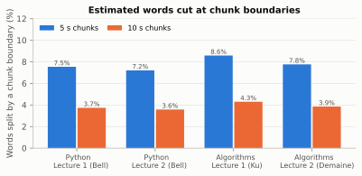
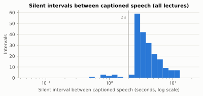

# EduStream Dataset: Exploratory Data Analysis

**Milestone:** M1, 14 Oct 2026. **Dataset:** 4 MIT OpenCourseWare lectures, 3.04 h of audio, 25,461 caption words. The dataset is documented in `docs/DATASET.md`.

**Reproduce:**
1. `.venv\Scripts\python tools\fetch_dataset.py` downloads and verifies the data.
2. `.venv\Scripts\python analysis\dataset_eda.py` regenerates every table in [tables/](tables/) and every figure in [figures/](figures/).

All numbers below are copied from those generated tables. The analysis uses no Kafka and no Whisper: audio is decoded to 16 kHz mono with PyAV, exactly as the pipeline will see it, and captions are parsed from the SubRip files.

> **Supersedes** [EDA_REPORT.md](EDA_REPORT.md), which was a schema-level analysis of a 10-message synthetic sample. That report also misstates the `generated_notes` payload: the field is `transcript`, not `notes` (defect D16).

## The four lectures

Throughout this report, the lectures are referred to by the short names below. The internal IDs appear only in the generated CSV tables, which also include a `lecture` column with the short name.

| Short name | Full title | Course | Speaker | Internal ID |
|---|---|---|---|---|
| **Python · Lecture 1 (Bell)** | What is Computation? | MIT 6.0001 Intro to CS and Programming in Python, Fall 2016 | Dr. Ana Bell | `ocw6001_l01` |
| **Python · Lecture 2 (Bell)** | Branching and Iteration | MIT 6.0001, Fall 2016 | Dr. Ana Bell | `ocw6001_l02` |
| **Algorithms · Lecture 1 (Ku)** | Algorithms and Computation | MIT 6.006 Introduction to Algorithms, Spring 2020 | Dr. Jason Ku | `ocw6006_l01` |
| **Algorithms · Lecture 2 (Demaine)** | Data Structures and Dynamic Arrays | MIT 6.006, Spring 2020 | Prof. Erik Demaine | `ocw6006_l02` |

---

## 1. Inventory

| Lecture | Used for | Duration | Audio track | Media size |
|---|---|---|---|---|
| Python · Lecture 1 (Bell) | demo, evaluation, quick tests | 43.1 min | AAC, 48 kHz, stereo, 81 kbps | 101 MB |
| Python · Lecture 2 (Bell) | evaluation | 43.5 min | AAC, 48 kHz, stereo, 81 kbps | 103 MB |
| Algorithms · Lecture 1 (Ku) | demo, evaluation | 45.6 min | AAC, 48 kHz, stereo, 81 kbps | 107 MB |
| Algorithms · Lecture 2 (Demaine) | demo, evaluation | 50.3 min | AAC, 48 kHz, stereo, 81 kbps | 118 MB |

**What the inventory shows:**
- The decoded durations match the container durations to within 0.04 s, so there are no truncated or corrupt files.
- All four lectures are captioned, which means every demo lecture also has a reference transcript.
- Each lecture is 43–50 min, so a 20-minute demo run uses less than half of a lecture.
- **The speakers are confirmed from the captions**, which label turns `JASON KU:` and `ERIK DEMAINE:`.

Source: `tables/dataset_inventory.csv`.

## 2. Audio quality

Loudness is the RMS level of each 5 s chunk, the unit the pipeline sends. "Silent" means quieter than −45 dBFS. The SNR proxy is the 90th minus the 10th percentile of 50 ms frame levels.

| Lecture | Median chunk level | p10 to p90 | Silent chunks | Noise floor | SNR proxy | Clipped samples |
|---|---|---|---|---|---|---|
| Python · Lecture 1 (Bell) | −21.2 dBFS | −23.9 to −19.9 | 0.58 % | −41.4 dBFS | 25.0 dB | 0 % |
| Python · Lecture 2 (Bell) | −24.0 dBFS | −27.7 to −22.1 | 1.53 % | −54.5 dBFS | 35.6 dB | 0 % |
| Algorithms · Lecture 1 (Ku) | −30.5 dBFS | −36.5 to −27.6 | 2.01 % | −70.3 dBFS | 44.9 dB | 0 % |
| Algorithms · Lecture 2 (Demaine) | −31.4 dBFS | −37.0 to −28.8 | 1.99 % | −61.9 dBFS | 35.7 dB | 0 % |

**What it shows:**
- **The recordings are clean and continuous.** Nothing is clipped. Silent chunks are 0.6–2.0 %, and the timelines show they fall almost entirely in the first and last chunk of each lecture. Short dips below about −40 dBFS appear only a handful of times per lecture.
- **The two courses differ in level by about 9 dB:** the Python lectures sit around −22 dBFS and the Algorithms lectures around −31 dBFS. A fixed dBFS threshold therefore doesn't transfer between recordings. One lecture's quiet passage is another's normal level.
- Python · Lecture 1 has the highest noise floor (−41 dBFS) and the lowest SNR proxy (25 dB). Hypothesis for M2 to test: of the four, it's the most likely to produce lower `asr_score` values.

Source: `tables/dataset_audio_quality.csv`.

## 3. Speech and captions

| Lecture | Words | Distinct words | MATTR (500) | Words per minute: median (p10–p90) | Windows < 40 wpm | Digit tokens |
|---|---|---|---|---|---|---|
| Python · Lecture 1 (Bell) | 6,363 | 916 | 0.371 | 150 (121–186) | 0 % | 1.34 % |
| Python · Lecture 2 (Bell) | 6,449 | 764 | 0.346 | 151 (122–181) | 0 % | 1.46 % |
| Algorithms · Lecture 1 (Ku) | 5,697 | 793 | 0.371 | 125 (84–164) | 2.22 % | 1.02 % |
| Algorithms · Lecture 2 (Demaine) | 6,952 | 883 | 0.389 | 140 (82–184) | 0 % | 1.88 % |

MATTR is the moving-average type–token ratio over 500-word windows. Unlike the raw ratio, it can be compared across lectures of different lengths.

**What it shows:**
- The **median speaking rate is 142 wpm** across all lectures (ranging from 125 to 151 by lecture), so a 30 s window holds about 60–75 words.
- Bell speaks steadily, staying within about ±30 wpm of her median. Ku and Demaine vary much more: their 10th percentile is about 82 wpm. *Unverified:* the dips may be board work or demonstrations. Watching the video at those times would confirm it.
- Only **2 windows out of all four lectures fall below 40 wpm**, both in Algorithms · Lecture 1, at about minute 12 and minute 20. These are stretches with little captioned speech, so a `SILENCE` rule at 40 wpm would raise about 0–2 informational alerts per lecture, a reasonable rate.

**Vocabulary** is clearly specific to each lecture's topic:

| Lecture | Top words |
|---|---|
| Python · Lecture 1 | *program, python, value* |
| Python · Lecture 2 | *loop, code, condition* |
| Algorithms · Lecture 1 | *algorithm, problem, time* |
| Algorithms · Lecture 2 | *array, insert, constant* |

That's good material for the Study Agent's full-text search and for the "top terms" window statistic. Digits are rare (1.0–1.9 % of tokens), so number formatting has little effect on WER.

Sources: `tables/dataset_transcript_stats.csv` and `tables/dataset_top_terms.csv`.

## 4. What the pipeline will see: chunks, boundaries, volume

Words are given estimated times by spreading each caption cue's words evenly over the cue. A word counts as "cut" when its estimated span crosses a chunk boundary.

| Chunk size | Words per chunk (median) | Chunks with zero words | **Words cut by a boundary** | Message size | `video_audio` volume per lecture |
|---|---|---|---|---|---|
| **5 s** | 11–13 | 2.5–2.7 % | **7.2–8.6 % (mean 7.8 %)** | 213.7 KB | 111–129 MB |
| **10 s** | 22–25.5 | 0.3–1.5 % | **3.6–4.3 % (mean 3.9 %)** | 427.1 KB | 111–129 MB |

**What it shows:**
- **Doubling the chunk length halves the share of words cut at boundaries**, from 7.8 % to 3.9 %, and **costs nothing in Kafka volume**, which stays at about 111–129 MB per lecture. The price is latency: each chunk takes 5 s longer to fill.
- Cut words are the main reason a chunked transcript is worse than one made from the whole lecture, so this trade-off becomes the 5 s vs 10 s experiment in M2. *Unverified:* that halving the cuts actually lowers WER.
- The 10 s message (427 KB) is still well under Kafka's 1 MB limit and the `CHUNK_SECONDS ≤ 15` cap.

Source: `tables/dataset_chunk_stats.csv`.

## 5. Silences and data quality

| Lecture | Cues | Empty cues | Annotations | Speaker labels | Speech begins | After last caption | Caption coverage | Silent intervals (median, p90) | Silent time |
|---|---|---|---|---|---|---|---|---|---|
| Python · Lecture 1 (Bell) | 928 | 40 | 0 | 1 | 30.0 s | 8.8 s | 92.6 % | 38 (3.3 s, 5.8 s) | 5.9 % |
| Python · Lecture 2 (Bell) | 898 | 54 | 4 | 9 | 31.1 s | 7.7 s | 90.7 % | 49 (3.7 s, 6.4 s) | 7.8 % |
| Algorithms · Lecture 1 (Ku) | 853 | 63 | 14 | 35 | 12.6 s | 5.3 s | 90.3 % | 58 (3.5 s, 6.5 s) | 9.0 % |
| Algorithms · Lecture 2 (Demaine) | 1,023 | 71 | 10 | 25 | 14.4 s | 5.7 s | 89.1 % | 64 (4.2 s, 7.9 s) | 10.2 % |

**What it shows:**
- **The captions are well formed.** No cues overlap, the timings are monotonic, and 89–93 % of each lecture is covered by speech cues.
- Consecutive speech cues usually touch: 93–96 % of transitions have no gap. Silence appears only as explicit empty or annotation-only cues, and **almost all of those last ≥ 2 s**. The captioners evidently mark only long pauses, so short pauses can't be measured from these captions.
- **Both Python lectures open with MIT's Creative Commons notice, about 19 s long, which is captioned.** The Algorithms captions don't contain it; they open with sound annotations (`[SQUEAKING]`, `[RUSTLING]`, `[CLICKING]`). The notice is excluded from all speech statistics and must also be excluded from WER.
- **The captions are edited, not verbatim.** There are **zero** "um" or "uh" tokens in all four lectures, but real lecture speech contains plenty. So WER against these captions counts any filler Whisper writes as an error. The paper must say so, and the normalisation must stay fixed across experiments.
- **Audience speech is in the reference.** Turns labelled `STUDENT:` (17 in Algorithms · Lecture 1) and `AUDIENCE:` (4 in Python · Lecture 2, 11 in Algorithms · Lecture 2) are short and often far from the microphone. They are kept in the reference, and their effect on WER is reported separately.

Source: `tables/dataset_data_quality.csv`.

## 6. Budget for the LLM and storage

With `NOTE_EVERY_N_WINDOWS = 2`, a call's size is the window pair's words × 1.33 tokens per word, plus about 700 tokens of instructions and memory and about 300 output tokens. These are estimates; M2 measures real token counts.

| Lecture | 30 s windows | LLM calls | Tokens per call | Tokens per full lecture |
|---|---|---|---|---|
| Python · Lecture 1 (Bell) | 87 | 44 | ~1,200 | ~52.8 k |
| Python · Lecture 2 (Bell) | 88 | 44 | ~1,200 | ~52.8 k |
| Algorithms · Lecture 1 (Ku) | 92 | 46 | ~1,170 | ~53.6 k |
| Algorithms · Lecture 2 (Demaine) | 101 | 51 | ~1,190 | ~60.5 k |

**What it means:**
- **A 20-minute demo run with three lectures costs about 72 k tokens.** At 3 calls a minute that's about 3,500 tokens a minute, below Groq's reported limit of 6,000 tokens a minute.
- **Groq's reported 200 k tokens a day allows only about 2–3 full rehearsals.** Cerebras, at a reported 1 M a day, allows about 14. That confirms the provider order (Cerebras first) and the rule of keeping `LLM_ENABLED=false` during development.
- **Kafka disk:** one run over all four full lectures writes about 470 MB to `video_audio` at RF 1, or about 1.4 GB with three brokers at RF 3. With 7-day retention, `reset.ps1` between runs is needed, not optional.

Source: `tables/dataset_pipeline_projection.csv`.

## 7. Implications for the design

| Parameter or assumption | Evidence | Recommendation / status |
|---|---|---|
| `CHUNK_SECONDS` (default 5) | 10 s halves the words cut at boundaries (7.8 → 3.9 %) at the same Kafka volume, but adds 5 s of latency | **Keep 5 s provisionally.** Let M2 decide by WER: 5 s vs 10 s chunks on all four lectures |
| Alert guards counted in chunks (`chunk_count ≥ 3`, lag > 6 records) | Both silently assumed 5 s chunks. At 10 s a full window holds only 3 chunks, so one lost chunk would block the alert, and "6 records" would mean 60 s of lag instead of 30 s | **Fixed (14 Oct)** in ARCHITECTURE §7. Both guards are now in **seconds of audio**: `covered_s ≥ WINDOW_SECONDS / 2` (15 s), and lag × `CHUNK_SECONDS` > 30 s. Tests at both chunk sizes were added to S-1 |
| `SILENCE` rule (`words_per_min < 40` or `no_speech_avg > 0.6`) | Fewer than 40 wpm occurs in 0–2.2 % of windows and matches stretches with little speech. Absolute dBFS levels differ by about 9 dB between courses | **Keep the rule as specified**, and **don't add a dBFS rule** |
| `T_SCORE` (initially 0.55) | Can't be estimated without Whisper output | Calibrate in M2 and M9 against per-window WER. Python · Lecture 1, the noisiest, is the first to check |
| Window size 30 s | About 60–75 words per window (142 wpm median) | Enough text for a meaningful note. **Keep it** |
| LLM provider order | 3 lectures need about 72 k tokens per 20-minute run. Groq allows about 2–3 runs a day | **Cerebras first, Groq second** (as planned). Keep the LLM off for development runs |
| Kafka retention | About 470 MB per full run at RF 1 | **Run `reset.ps1` between runs** |
| WER methodology | The captions have no fillers, include audience turns, and the Python lectures contain the notice | Strip the notice; apply one fixed normalisation; report the effect of the audience turns separately |
| Demo partitions | 3 demo lectures (Bell, Ku, Demaine) | `tools/partition_of.py` picks `video_id`s that land on partitions 0, 1 and 2 |

**Contradictions with the architecture:** one was found (the chunk-counted guards), and it is now fixed.

## 8. Limitations of this EDA

- **Word times are estimated.** Captions give one time span per cue (about 1–4 s), not per word. The boundary-cut figures assume words are spread evenly within each cue. M2 checks them against Whisper's word timestamps.
- **Short pauses can't be seen.** The captions only mark silences of about 2 s or more.
- **Loudness is measured on AAC-compressed, down-mixed audio.** The levels are relative measures for comparing lectures, not calibrated sound pressure.
- **The sample is small and narrow:** 4 lectures, 2 courses and 3 speakers, all MIT computer science and US-accented English. The statistics describe this dataset, not lectures in general.
