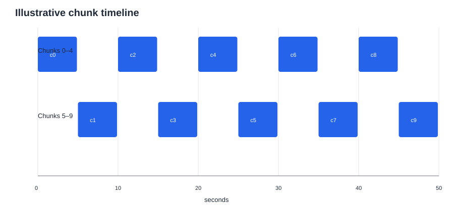
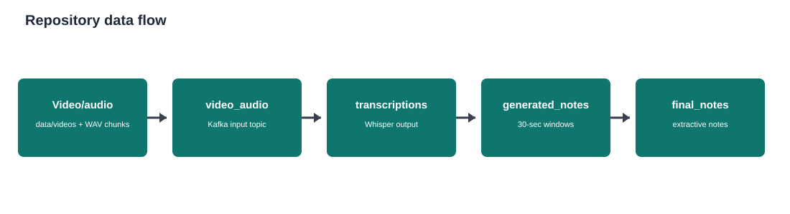

# Dataset Description and Exploratory Data Analysis

## Executive summary

This repository is an educational-stream processing application, not a repository
containing a persisted analytical dataset. No CSV, Parquet, Excel, JSON, database,
or notebook data files are present, and no Kafka broker or exported topic data is
available in the workspace.

The analysis below is therefore split into:

1. **Observed implementation contract**: schemas, fields, transformations, and
   processing windows inferred directly from the source code.
2. **Illustrative EDA**: descriptive tables and figures generated from the
   deterministic ten-message sample loop in `producer/producer.py`. These are
   not measurements of real lecture data.
3. **Production EDA plan**: the data required to calculate reliable distributions,
   missingness, quality, latency, and model-performance metrics.

## 1. Detailed dataset description

### Business/domain context

The pipeline turns lecture video/audio into time-aligned transcripts and short
extractive notes:

`video/audio -> audio chunks -> Kafka video_audio -> Whisper transcriptions ->
Kafka Streams 30-second windows -> generated_notes -> final_notes`

See `figures/repository_data_flow.svg` for the pipeline image.

### Data entities and stages

| Stage | Storage/transport | Grain | Main fields | Transformation |
|---|---|---|---|---|
| Input sample | Python producer | One message per 5-second chunk | `video_id`, `chunk_id`, `timestamp`, `text` | Emits exactly 10 illustrative messages |
| Audio event | Kafka `video_audio` | One message per WAV chunk | `video_id`, `chunk_id`, `start_time`, `end_time`, `audio_path` | Publishes discovered WAV files |
| Transcript event | Kafka `transcriptions` | One message per processed chunk | `video_id`, `chunk_id`, `start_time`, `end_time`, `text` | Whisper transcribes each WAV |
| Window aggregate | Kafka Streams state store/topic | One record per video and 30-second window | `video_id`, `window_start`, `window_end`, `transcript` | Concatenates transcript text |
| Notes event | Kafka `generated_notes` | One record per video/window | `video_id`, `window_start`, `window_end`, `notes` | Keeps up to five sentences with at least five words |
| Final output | Kafka `final_notes` | Intended downstream notes output | Not specified in the inspected source | Topic is configured by the note generator |

The full field-level dictionary is available in
`tables/field_dictionary.csv`.

### Data types, units, and constraints

- `video_id`: string identifier; the local sample uses only `lecture_01`.
- `chunk_id`: zero-based integer identifier.
- Time values in the Python producer are seconds; Kafka Streams converts
  `start_time` to milliseconds for event-time windowing and emits seconds again.
- Audio chunks are configured for 5 seconds, mono, 16 kHz, PCM 16-bit WAV.
- Aggregation windows are 30 seconds with a 5-second grace period.
- Notes are an array of at most five strings; sentences shorter than five words
  are excluded by the implemented summarizer.
- The sample producer's `timestamp` field is not the same schema as the
  production audio-event fields (`start_time`, `end_time`).

## 2. Illustrative EDA

### Availability and scope

| Metric | Value | Interpretation |
|---|---:|---|
| Persisted datasets found | 0 | No local data file can support empirical EDA |
| Observable producer rows | 10 | Deterministic illustrative loop only |
| Distinct `video_id` values | 1 | `lecture_01` only |
| Chunk IDs | 0–9 | Complete and consecutive in the sample |
| Time range | 0–45 seconds | Ten 5-second positions |
| Expected nominal coverage | 50 seconds | From 10 chunks × 5 seconds |
| Sample text word count | 6 per row | Synthetic repeated template, not transcript language |

### Illustrative sample preview

The generated table is available at `tables/illustrative_input_messages.csv`.

| video_id | chunk_id | timestamp_seconds | text | text_word_count |
|---|---:|---:|---|---:|
| lecture_01 | 0 | 0 | This is lecture audio chunk 0 | 6 |
| lecture_01 | 1 | 5 | This is lecture audio chunk 1 | 6 |
| lecture_01 | 2 | 10 | This is lecture audio chunk 2 | 6 |
| ... | ... | ... | ... | ... |
| lecture_01 | 9 | 45 | This is lecture audio chunk 9 | 6 |

### Distributions and integrity checks

| Check | Result | Assessment |
|---|---:|---|
| Duplicate `(video_id, chunk_id)` pairs | 0 | Pass for the illustrative loop |
| Missing chunk IDs | 0 | Pass for IDs 0–9 |
| Non-monotonic timestamps | 0 | Pass |
| Timestamp step size | 5 seconds | Matches configured chunk duration |
| Null fields | 0 | Pass in the constructed sample |
| Text length variability | 0 | No variability; synthetic template |



The timeline confirms the intended regular spacing, but it does not confirm
actual media duration or Kafka delivery timing.



## 3. Findings and data-quality risks

1. **No empirical dataset is available locally.** Counts, distributions,
   transcript quality, lecture topics, language, and note quality cannot be
   estimated from this repository.
2. **The sample is synthetic.** Its repeated six-word template is unsuitable
   for NLP statistics such as vocabulary richness, stopword rates, topic
   coverage, or summarization quality.
3. **Schema drift risk exists.** The simple sample producer emits `timestamp`,
   while the audio/transcription path expects `start_time` and `end_time`.
4. **Lineage should be preserved.** A production export should include Kafka
   topic, partition, offset, event timestamp, processing timestamp, and model
   metadata so latency and replay behavior can be measured.
5. **Audio/file completeness is not measurable.** The actual `data/` directory
   and generated WAV files are absent from the workspace.
6. **Note-generation evaluation is absent.** There are no human reference
   summaries or annotation fields with which to calculate ROUGE, factuality,
   coverage, or human preference.

## 4. Recommended production EDA once topic data is exported

Export one row per event from `video_audio`, `transcriptions`,
`generated_notes`, and `final_notes`, retaining event and processing timestamps.
Then calculate:

- volume by `video_id`, topic, partition, hour, and processing run;
- missingness and schema-validity rates for every field;
- duplicate and out-of-order chunk rates;
- chunk duration and transcript character/word distributions;
- language, silence, and transcription confidence distributions (if available);
- event-time-to-processing-time latency percentiles (P50/P95/P99);
- 30-second window coverage, overlap, late-arrival, and dropped-window rates;
- notes-per-window, sentence lengths, and compression ratio;
- model quality against human references or a labeled QA sample.

## Reproducibility

Run the following from the repository root to regenerate the CSV tables and SVG
figures:

```powershell
& "C:\Users\Atharva Srivastava\AppData\Local\Programs\Python\Python310\python.exe" analysis\generate_eda.py
```

The generator uses only the Python standard library and does not connect to
Kafka, read external files, or modify application dependencies.
